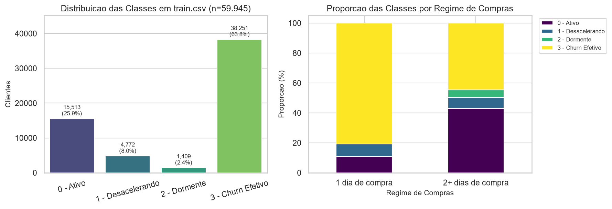
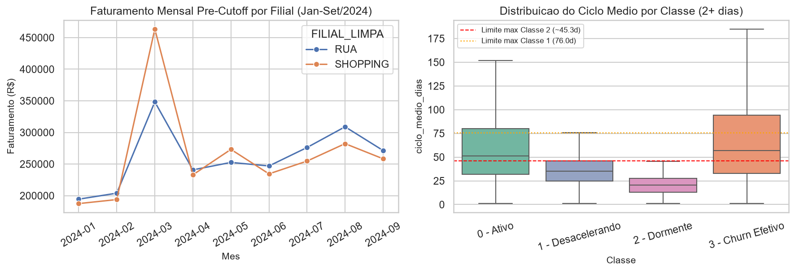
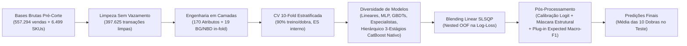
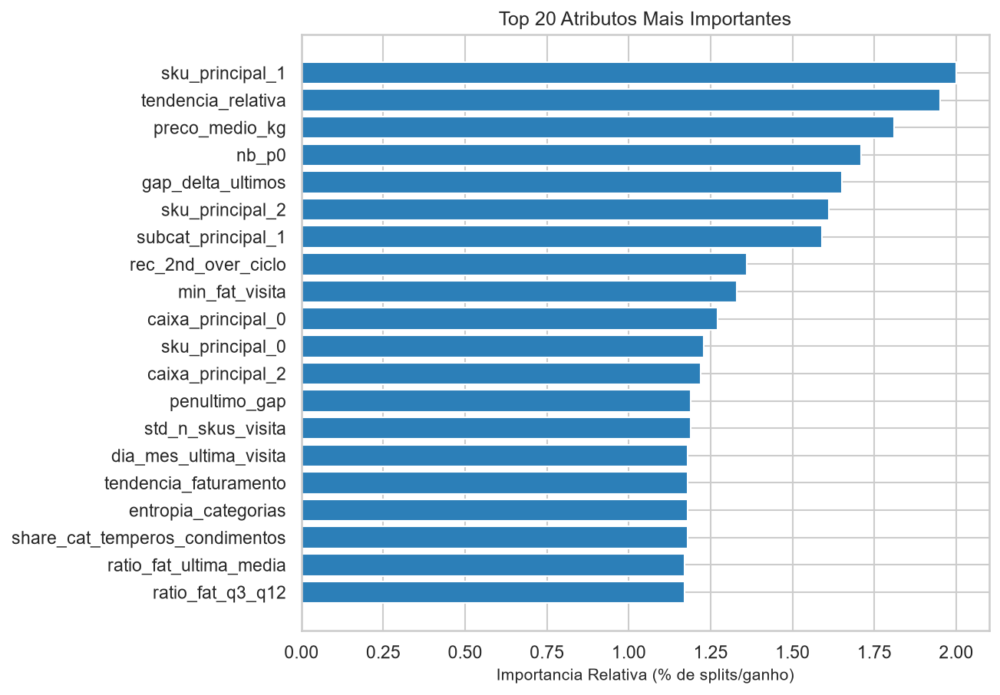
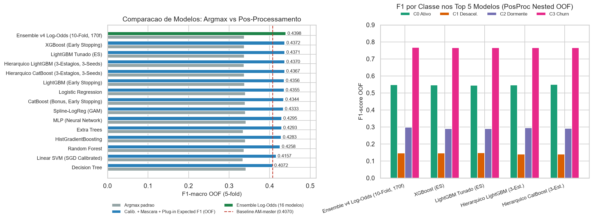
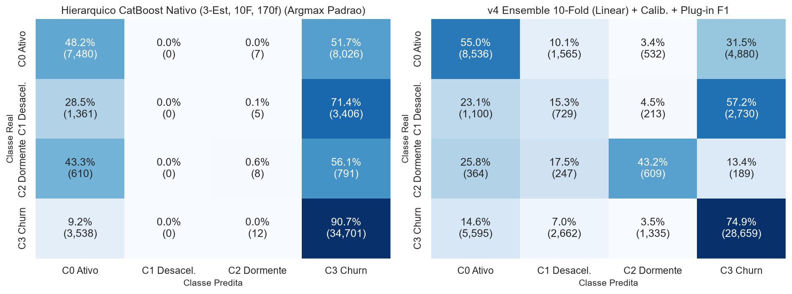
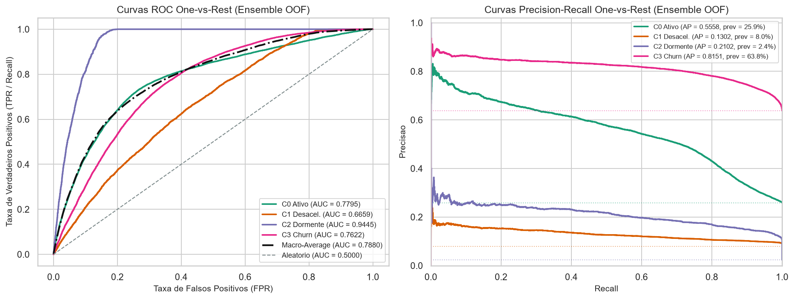
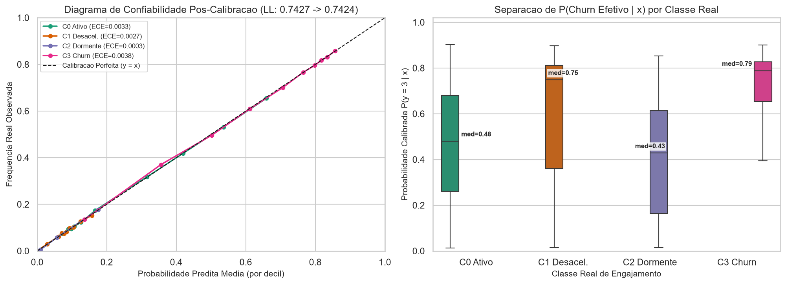
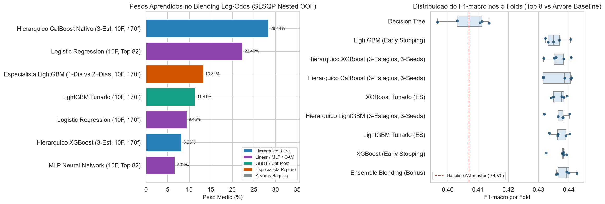

# Previsão de Engajamento e Churn de Clientes no Varejo — VAI Store


-0.4398-1b9e77)


Projeto Final da disciplina de **Aprendizado de Máquina** ([UFSCar — Campus Sorocaba](https://www.sorocaba.ufscar.br/), Prof. Dr. Tiago A. Almeida, 2026), desenvolvido sobre transações reais e anonimizadas da rede varejista **VAI Store** em parceria com a consultoria **Visagio**.

O objetivo é prever o nível de engajamento futuro de **59.945 clientes no treino** e **25.691 no teste** nos **90 dias após a data de corte (`30/09/2024`)**, modelando um cenário de **varejo não contratual** com forte desbalanceamento entre quatro classes, dois regimes comportamentais distintos e histórico limitado a nove meses pré-corte.

---

## Sumário

1. [Visão Geral do Problema](#1-vis%C3%A3o-geral-do-problema)
2. [Arquitetura da Solução (Zero Data Leakage)](#2-arquitetura-da-solu%C3%A7%C3%A3o-zero-data-leakage)
3. [Limpeza Pré-Cutoff e Descobertas Exploratórias](#3-limpeza-pr%C3%A9-cutoff-e-descobertas-explorat%C3%B3rias)
4. [Engenharia de Atributos (170 Base + BG/NBD In-Fold)](#4-engenharia-de-atributos-170-base--bgnbd-in-fold)
5. [Modelagem, Pós-Processamento Plug-in e Protocolo 10-Fold Nested OOF](#5-modelagem-p%C3%B3s-processamento-plug-in-e-protocolo-10-fold-nested-oof)
6. [Resultados Experimentais](#6-resultados-experimentais)
7. [Estrutura do Repositório](#7-estrutura-do-reposit%C3%B3rio)
8. [Como Reproduzir Localmente](#8-como-reproduzir-localmente)
9. [Relatório Científico (IEEE LaTeX)](#9-relat%C3%B3rio-cient%C3%ADfico-ieee-latex)
10. [Autores e Referências](#10-autores-e-refer%C3%AAncias)

---

## 1. Visão Geral do Problema

Diferentemente de modelos por assinatura, no varejo físico o cliente não formaliza o cancelamento: ele apenas espaça as visitas até interromper as compras. A partir do histórico pré-corte (`01/01/2024` a `30/09/2024`), o modelo classifica cada consumidor em uma de quatro classes exclusivas nos 90 dias subsequentes:

| Classe | Rótulo | Regra de Definição (90 dias pós-corte) | Clientes no Treino | Proporção |
| :---: | :--- | :--- | :---: | :---: |
| **C0** | **Ativo** | Nova compra em até `1,2x` o ciclo médio habitual | 15.513 | **25,88%** |
| **C1** | **Desacelerando** | Recompra com atraso entre `1,2x` e `2,0x` o ciclo médio | 4.772 | **7,96%** |
| **C2** | **Dormente** | Recompra com atraso acima de `2,0x` o ciclo médio | 1.409 | **2,35%** |
| **C3** | **Churn Efetivo** | Nenhuma compra registrada no trimestre futuro | 38.251 | **63,81%** |

### Principais Desafios do Domínio
- **Forte desbalanceamento:** a Classe 2 soma apenas **2,35%** das amostras, fazendo com que a regra ingênua `argmax` zere previsões na Classe 1 e quase elimine a Classe 2 (`0,4%` de revocação).
- **Dois regimes estruturais:** **53,10%** da base (`31.829` clientes no treino) compraram em **um único dia** pré-corte e não possuem ciclo médio prévio, acumulando **80,7% de Churn** e **zero casos da Classe 2**. Entre recorrentes (**2+ dias**, `46,90%`), o *churn* cai para `44,7%` e todas as quatro classes ocorrem.
- **Horizonte futuro fixo (90 dias):** apenas clientes com ciclo curto conseguem atingir atraso superior a `2,0x` dentro da janela de 90 dias — no treino, a Classe 1 ocorre até `ciclo_medio_dias <= 76,0` dias e a Classe 2 até `ciclo_medio_dias <= 45,33` dias (média `20,35` dias e `6,10` compras).
- **Armadilha de filtros de outliers:** o corte multivariado clássico por intervalo interquartil (`1,5x IQR`) confunde clientes frequentes com ruído, descartando **32,7% do treino** e suprimindo **55,9% da Classe 2**.

<p align="center">
  
</p>

<p align="center">
  
</p>

---

## 2. Arquitetura da Solução (Zero Data Leakage)

Todo o fluxo segue separação rigorosa entre pré-corte (`<= 30/09/2024`) e avaliação fora da amostra (`Nested Out-of-Fold`):



---

## 3. Limpeza Pré-Cutoff e Descobertas Exploratórias

No script [scripts/preprocessamento.py](scripts/preprocessamento.py), as tabelas transacionais brutas passam por auditoria temporal estrita (`dt <= 2024-09-30`):

| Etapa de Auditoria / Limpeza | Quantidade | Ação Adotada |
| :--- | :---: | :--- |
| Linhas brutas em `vendas_dirty.csv` | **557.294** | Base transacional completa de entrada |
| Datas corrompidas recuperadas via `COD_ATEND` | **1.113** | Reconstrução da data real antes do filtro de corte |
| Registros dentro da janela (`01/01/2024` a `30/09/2024`) | **402.420** | Corte temporal estrito (`assert max <= 2024-09-30`) |
| Linhas pré-corte sem CPF | **3.985** | Removidas (sem vínculo possível ao cliente) |
| Duplicatas exatas / por `COD_VENDA` | **367** / **443** | Deduplicação determinística |
| Filiais sujas corrigidas via `COD_FILIAL` | **812** | Padronização em `RUA` (`101032`) e `SHOPPING` (`101042`) |
| Quantidades / faturamentos inválidos ou nulos | **8.875** / **8.695** | Conversão segura para `NaN` e *capping* p99,95 por unidade (`UN`/`KG`) |
| Produtos em `produto_dirty.csv` | **6.499** | Deduplicação de SKU e recuperação de 5 SKUs sem categoria |
| **Transações limpas finais pré-corte** | **397.625** | Base consolidada para extração da Camada B |

### Padrões Relevantes na EDA
- **Sazonalidade em 2024:** o volume cresce de `37.214` vendas em janeiro ao pico de `51.206` em agosto (`+37,6%`), encerrando setembro com `47.034`.
- **Diferença entre canais:** unidades de `RUA` (`28.441` clientes) apresentam maior recorrência (`50,8%` vs. `43,4%`) e menor *churn* (`60,9%` vs. `66,5%`), enquanto lojas de `SHOPPING` (`31.504` clientes) registram tíquete médio **19% superior** (`R$ 14,49` vs. `R$ 12,18`).

---

## 4. Engenharia de Atributos (170 Base + BG/NBD In-Fold)

Construímos a matriz de representação em camadas progressivas no mesmo módulo [scripts/preprocessamento.py](scripts/preprocessamento.py):

1. **Originais (`14` atributos):** compras, itens, faturamento, tíquete médio, SKUs, recência, antiguidade, ciclo médio, desvio de ciclo, proporção a granel, categorias, dias com compra, filial e tendência de gasto.
2. **Camada A — Razões Estruturais e Folgas RFM (`+32`, `46` variáveis):** indicadores de regime (`is_single_day`, `can_be_class1`, `can_be_class2`), atraso relativo (`recencia_sobre_ciclo`, `atraso_zscore`), coeficiente de variação de ciclo e frações disponíveis dentro da janela de 90 dias frente a `1,2x` e `2,0x` o ciclo (`janela_frac_c0`, `janela_frac_c1`, `janela_frac_c2`).
3. **Camada B — Histórico Transacional Limpo (`+124`, `170` base):** janelas móveis (`7`, `14`, `21`, `30`, `45`, `60`, `90`, `180` dias e trimestres Q1–Q3), dinâmica entre últimos retornos (`ultimo_gap`, `penultimo_gap`, `gap_delta_ultimos`, `ewm_gap_recent`), dados da penúltima visita, inclinação linear de faturamento, *streak* mensal por bitmask, preço médio/kg, entropia de Shannon por categoria, *shares* dos Top 12 SKUs e categorias, além de 4 variáveis categóricas de alta cardinalidade (`sku_principal`, `subcat_principal`, `cat_principal`, `caixa_principal`).
4. **BG/NBD + Processo de Renovação Log-Normal (`+19` dinâmicas in-fold):** ajustados de forma não supervisionada (sem `y`) dentro de cada dobra pelo transformador `BGNBDFeatureTransformer` (Fader, Hardie & Lee, 2005), gerando `bgnbd_p_alive`, `bgnbd_lam_day`, `nb_p0..nb_p3`, `log_nb_p0..log_nb_p3`, `rec_p0..rec_p3` e `ren_p0..ren_p3` (totalizando **201 variáveis efetivas** nos modelos em árvore).
5. **Seleção OOF (`Top 82`):** avaliação comparativa por ganho médio OOF entre `170`, `Top 82` e `Top 58` atributos base, elevando o F1-macro do LightGBM de `0,4347` para `0,4356` e reduzindo ruído em modelos lineares e neurais.

<p align="center">
  
</p>

Os maiores ganhos concentram-se em **`nb_p0` (`45,2 mil`)**, **`atraso_zscore` (`20,0 mil`)**, **`nb_p3` (`13,9 mil`)**, **`log_nb_p0` (`12,4 mil`)**, **`ciclo_medio_dias` (`9,2 mil`)**, **`janela_frac_c0` (`9,1 mil`)** e **`gap_delta_ultimos` (`7,2 mil`)** — justamente os sinais que combinam probabilidade analítica de atividade/recompra com o ritmo recente de retorno frente à janela de 90 dias.

---

## 5. Modelagem, Pós-Processamento Plug-in e Protocolo 10-Fold Nested OOF

### Algoritmos e Arquiteturas Avaliadas ([scripts/experimentos.py](scripts/experimentos.py))
- **11 classificadores clássicos e neurais (5-Fold):** Regressão Logística L2, GAM com *Splines* cúbicos, Linear SVM calibrado, Árvore de Decisão, Random Forest, Extra Trees, MLP `(64, 32)`, HistGradientBoosting, XGBoost, LightGBM e CatBoost (com *Target Encoding* interno de 5 dobras nos modelos sem suporte categórico nativo; *Winsorizer* p99,5 + mediana + escalonamento para lineares/SVM/MLP).
- **Especialistas por Regime:** modelos independentes para `1-Dia` (`{0, 1, 3}`) e `2+Dias` (`{0, 1, 2, 3}`).
- **Decomposição Hierárquica em 3 Estágios (CatBoost Nativo):** alinha a classificação ao processo gerador em três problemas binários condicionais multiplicados em cadeia:
  1. **Estágio 1:** `P(Recompra | x) = P(y != 3 | x)` em 100% da base;
  2. **Estágio 2:** `P(Atraso | Recompra, x) = P(y in {1, 2} | y != 3, x)`;
  3. **Estágio 3:** `P(Dormente | Atraso, x) = P(y == 2 | y in {1, 2}, n_dias >= 2, ciclo <= 46,5)`.
  Utiliza `Pool(..., cat_features=...)` no **CatBoost Hierárquico Nativo** (*Ordered Target Statistics* sem vazamento).

### Por que `argmax` falha e como o Plug-in Expected Macro-F1 ganha `+0,0972`
Técnicas de reamostragem como SMOTE (`Log-Loss = 0,7683`) e `class_weight="balanced"` (`Log-Loss = 1,0354`) distorcem severamente a calibração probabilística. Em vez disso:
1. Mantivemos as **proporções originais** no treinamento para produzir probabilidades bem calibradas;
2. Aplicamos **calibração logística por temperatura + viés** (`ECE = 0,0025`);
3. Aplicamos **máscara estrutural** zerando `C2` para clientes de `1-Dia` ou `ciclo > 46,5` dias e zerando `C1` quando recorrente com `ciclo > 77,0` dias;
4. Executamos a regra de ponto fixo **Plug-in Expected Macro-F1** (Lipton et al., 2014), que otimiza multiplicadores e deslocamentos afins diretamente sobre $P(y \mid x)$ para maximizar o F1-macro esperado **sem consultar rótulos de teste**.

### Protocolo Final em 10 Partições e Nested OOF
Na etapa final (`executar_pipeline_10fold_170f`), 10 modelos diversos são treinados sobre **as mesmas 10 partições estratificadas** (`90%` treino por dobra, parada antecipada interna de `10%` a `12%`), usando a **média das probabilidades das 10 dobras** no conjunto de teste. Pesos do comitê (SLSQP na Log-Loss), calibração logística e limiares *Plug-in* são ajustados em esquema **Nested OOF** (para cada dobra $k$, estimam-se os parâmetros nas outras 9 dobras e avalia-se fora da amostra em $k$).

---

## 6. Resultados Experimentais

### Estudos de Ablação (CV 5-Fold Estratificada)

| Estudo | Configuração | F1-Macro ± DP | AUC-OvR | Log-Loss |
| :--- | :--- | :---: | :---: | :---: |
| **Exp. 1 (Limpeza)** | Filtro IQR `1,5x` + Mediana + Random Forest (`balanced`) | 0,4054 ± 0,0029 | 0,7527 | — |
| | Sem IQR (`100%` dados) + Mediana + Random Forest | 0,4152 ± 0,0044 | 0,7578 | — |
| | Sem IQR + NaN Nativo + LightGBM + Regra Bayes | **0,4255 ± 0,0041** | **0,7806** | — |
| **Exp. 2 (Atributos)** | Originais (`14` atributos) | 0,4331 ± 0,0042 | 0,7838 | 0,7469 |
| | + Camada A (`46` variáveis) | 0,4309 ± 0,0031 | 0,7842 | 0,7462 |
| | + Camada A+B + BG/NBD (`170` base / `201` efetivas) | 0,4347 ± 0,0033 | **0,7864** | **0,7442** |
| | Recorte selecionado **Top 82** (LightGBM) | **0,4356 ± 0,0033** | 0,7861 | 0,7446 |
| **Exp. 3 (Decisão)** | Linha de base `argmax` (sem balanceamento) | 0,3389 ± 0,0039 | **0,7859** | 0,7451 |
| | SMOTE no fold de treino (`argmax`) | 0,3842 ± 0,0070 | 0,7818 | 0,7683 |
| | `class_weight="balanced"` (`argmax`) | 0,3983 ± 0,0046 | 0,7577 | 1,0354 |
| | Peso suave ($\alpha = 0{,}5$, `argmax`) | 0,4114 ± 0,0027 | 0,7778 | 0,8097 |
| | **Calibração + Máscara + Plug-in Expected Macro-F1** | **0,4361 ± 0,0052** | **0,7859** | **0,7447** |

### Comparação de Modelos, Testes Estatísticos e Public Leaderboard

| Modelo / Arquitetura | F1-Macro ± DP | AUC-OvR | Log-Loss | Protocolo |
| :--- | :---: | :---: | :---: | :---: |
| **Comitê Linear (SLSQP + Calib. + Plug-in)** | **0,4398 ± 0,0049** | **0,7880** | **0,7424** | 10-Fold (170f / Top 82) |
| Comitê Log-Odds (Pool 16 modelos) | 0,4388 ± 0,0028 | 0,7875 | 0,7427 | 5-Fold (Top 82) |
| XGBoost (Early Stopping) | 0,4372 ± 0,0027 | 0,7865 | 0,7440 | 5-Fold (Top 82) |
| LightGBM (Tunado via RandomizedSearchCV) | 0,4371 ± 0,0026 | 0,7865 | 0,7442 | 5-Fold (Top 82) |
| **CatBoost Hierárquico Nativo (3-Estágios)** | **0,4370 ± 0,0042** | **0,7874** | **0,7432** | 10-Fold (170f) |
| LightGBM (Early Stopping) | 0,4356 ± 0,0033 | 0,7861 | 0,7446 | 5-Fold (Top 82) |
| Regressão Logística L2 | 0,4355 ± 0,0031 | 0,7857 | 0,7449 | 5-Fold (Top 82) |
| Especialista LightGBM (1-Dia vs. 2+Dias) | 0,4353 ± 0,0050 | 0,7859 | 0,7440 | 10-Fold (170f) |
| CatBoost (Early Stopping) | 0,4344 ± 0,0029 | 0,7870 | 0,7441 | 5-Fold (Top 82) |
| Regressão com Splines (GAM) | 0,4333 ± 0,0047 | 0,7852 | 0,7456 | 5-Fold (Top 82) |
| Rede Neural MLP `(64, 32)` | 0,4295 ± 0,0060 | 0,7823 | 0,7493 | 5-Fold (Top 82) |
| Extra Trees | 0,4293 ± 0,0046 | 0,7822 | 0,7477 | 5-Fold (Top 82) |
| HistGradientBoosting | 0,4283 ± 0,0061 | 0,7838 | 0,7468 | 5-Fold (Top 82) |
| Florestas Aleatórias | 0,4258 ± 0,0056 | 0,7823 | 0,7486 | 5-Fold (Top 82) |
| SVM Linear (SGD Calibrado) | 0,4157 ± 0,0058 | 0,7528 | 0,7721 | 5-Fold (Top 82) |
| Árvore de Decisão | 0,4072 ± 0,0071 | 0,7644 | 0,7939 | 5-Fold (Top 82) |

- **Suporte Estatístico:** o teste de Friedman em 19 arquiteturas rejeitou igualdade ($\chi^2_F = 65{,}14$, $p = 2{,}95 \times 10^{-7}$) e o teste unilateral de Wilcoxon confirmou ganho do comitê sobre os concorrentes individuais ($p = 0{,}0312$).
- **Composição do Comitê Linear Final (10-Fold):** CatBoost Hierárquico Nativo (`28,44%`), Regressão Logística Top 82 (`22,40%`), Especialista LightGBM (`13,31%`), LightGBM Tunado 170f (`11,41%`), Regressão Logística 170f (`9,45%`), XGBoost Hierárquico (`8,23%`), MLP Top 82 (`6,71%`) e LightGBM Hierárquico (`0,06%`).
- **Teto Teórico Bayes (Monte Carlo, $n=20$):** **`0,4407 ± 0,0026`** — apenas **`0,0009`** acima do F1-macro obtido fora da amostra (`0,4398`).
- **Evolução no Public Leaderboard (Kaggle):** subimos de `0,43551` e `0,43294` (pipeline 5-Fold) para **`0,44075`** (Comitê Linear 10-Fold) e **`0,43716`** (CatBoost Hierárquico Nativo 10-Fold).

### Desempenho por Classe, Subgrupos e Diagnósticos de Generalização

| Classe / Subgrupo (OOF 10-Fold) | Precisão / Clientes | Revocação / Log-Loss | F1-Score | AUC-OvR | PR-AUC |
| :--- | :---: | :---: | :---: | :---: | :---: |
| **C0 — Ativo** | 0,5474 | 0,5502 | **0,5488** | 0,7795 | 0,5558 |
| **C1 — Desacelerando** | 0,1401 | 0,1528 | **0,1462** | 0,6659 | 0,1302 |
| **C2 — Dormente** | 0,2265 | **0,4322** | **0,2972** | **0,9445** | 0,2102 |
| **C3 — Churn Efetivo** | **0,7861** | **0,7492** | **0,7672** | 0,7622 | **0,8151** |

- **Subgrupos estruturais:** no regime `1-Dia` (`31.829` clientes), `Log-Loss = 0,6179`, `F1 C3 = 0,8759` e `F1 C0 = 0,0000` (previsões concentradas em Churn e Desacelerando); no regime `2+Dias` (`28.116` clientes), `Log-Loss = 0,8833`, `F1 C0 = 0,6168`, `F1 C2 = 0,2972` e `F1 C3 = 0,4440`. Por filial, `SHOPPING` alcança F1-macro de `0,4430` (`Log-Loss = 0,7125`) contra `0,4351` em `RUA` (`Log-Loss = 0,7755`).
- **Sem *dataset shift*:** validação adversarial 5-Fold LGBM entre `train.csv` e `test.csv` resultou em **`AUC = 0,5018 ± 0,0042`** (relatado como `0,5007` no artigo), indicando distribuições praticamente indistinguíveis.
- **Estabilidade amostral (*bootstrap* sem reposição, $300$ amostras):** Public LB ($n=7.707$) `0,4400 ± 0,0072` vs. Private LB ($n=17.984$) `0,4398 ± 0,0043` (concordância de `96,15%` entre a submissão principal e a salvaguarda individual).

<p align="center">
  
</p>

<p align="center">
  
</p>

<p align="center">
  
</p>

<p align="center">
  
</p>

<p align="center">
  
</p>

---

## 7. Estrutura do Repositório

```text
am-ufscar-2026-vai-store/
├── README.md                              # Documentação completa do projeto
├── main.ipynb                             # Notebook principal executável ponta a ponta (9 células)
├── requirements.txt                       # Dependências verificadas em Python 3.12
├── scripts/
│   ├── __init__.py                        # Inicializador do pacote scripts
│   ├── READ.ME                            # Guia de cabeçalho e modularização
│   ├── analise_exploratoria.py            # Auditoria estatística e gráficos estruturais de EDA
│   ├── preprocessamento.py                # Fallback DATA_DIR, limpeza <= 30/09/2024, Camada A/B e BG/NBD
│   ├── experimentos.py                    # Ablações, CV 5F/10F, Tuning, Hierárquicos, SLSQP e Plug-in F1
│   └── analise_resultados.py              # Friedman/Wilcoxon, ECE, Bayes MC, Adversarial e Bootstrap
├── figs/                                  # Logo institucional e figuras analíticas em PNG
└── relatorio/
    ├── relatorio.tex                      # Artigo científico em formato IEEE (máx. 4 págs + Referências)
    ├── referencias.bib                    # Referências bibliográficas em BibTeX
    ├── IEEEtran.cls / IEEEtran.bst        # Classe e estilo oficial IEEEtran
    ├── gerar_figuras_ieee.py              # Script de geração das figuras vetoriais PDF (1 coluna)
    └── figs/                              # Figuras vetoriais (.pdf) incluídas no artigo
```

> **Nota sobre dados e submissões:** conforme as regras da competição acadêmica, os arquivos brutos (`train.csv`, `test.csv`, `sample_submission.csv`, `vendas_dirty.csv`, `produto_dirty.csv`), o cache local (`cache/`) e os CSVs de predição (`outputs/`) são propositalmente omitidos do repositório público.

---

## 8. Como Reproduzir Localmente

1. **Clonar o repositório e criar ambiente Python 3.12:**
   ```bash
   git clone https://github.com/felipe-bas/am-ufscar-2026-vai-store.git
   cd am-ufscar-2026-vai-store
   python -m venv .venv
   # Windows: .venv\Scripts\activate  |  Linux/macOS: source .venv/bin/activate
   pip install -r requirements.txt
   ```

2. **Posicionar os 5 CSVs originais da competição:**
   Coloque `train.csv`, `test.csv`, `sample_submission.csv`, `vendas_dirty.csv` e `produto_dirty.csv` na pasta `ufs-car-am-2026-projeto-final/` (ou diretamente na raiz `./`, em `data/` ou `dados/` — a função `resolver_diretorio_dados` localiza os arquivos automaticamente).

3. **Executar o pipeline completo:**
   ```bash
   python -m nbconvert --to notebook --execute --inplace --ExecutePreprocessor.timeout=900 main.ipynb
   ```
   - O notebook cria automaticamente `cache/`, `figs/` e `outputs/`, executa todas as ablações, modelos individuais (5-Fold e 10-Fold), comitê SLSQP, calibração, diagnóstico adversarial/bootstrap e salva as submissões finais validadas em `outputs/`.
   - Para recalcular do zero ignorando checkpoints em disco, altere `USAR_CACHE = False` na Célula 2 de `main.ipynb`.

---

## 9. Relatório Científico (IEEE LaTeX)

O artigo completo em português seguindo o padrão `IEEEtran` (`10pt`, `conference`, `compsocconf`, até 4 páginas em coluna dupla excluindo Referências) encontra-se em [relatorio/relatorio.tex](relatorio/relatorio.tex). Para compilar localmente (após carregar o projeto no Overleaf ou com TeX Live / MiKTeX instalado):

```bash
cd relatorio
pdflatex relatorio.tex
bibtex relatorio
pdflatex relatorio.tex
pdflatex relatorio.tex
```

Para regenerar as figuras vetoriais de 1 coluna (`relatorio/figs/*.pdf`) após rodar o `main.ipynb`:

```bash
python relatorio/gerar_figuras_ieee.py
```

---

## 10. Autores e Referências

**Autores — Departamento de Computação (DComp), UFSCar Sorocaba (2026):**
- **Felipe Rodrigues Bastos** — RA `815406` — `felipe.bastos@estudante.ufscar.br` — [@felipe-bas](https://github.com/felipe-bas)
- **João Henrique de Camargo Brants** — RA `802553` — `joaobrants@estudante.ufscar.br`

**Principais Referências Bibliográficas:**
- Fader, P. S., Hardie, B. G. S., & Lee, K. L. (2005). *"Counting Your Customers" the Easy Way: An Alternative to the Pareto/NBD Model*. Marketing Science.
- Lipton, Z. C., Elkan, C., & Naryanaswamy, B. (2014). *Optimal Thresholding of Classifiers to Maximize F1 Measure*. ECML PKDD.
- Prokhorenkova, L., et al. (2018). *CatBoost: unbiased boosting with categorical features*. NeurIPS.
- Silla, C. N., & Freitas, A. A. (2011). *A survey of hierarchical classification across different application domains*. Data Mining and Knowledge Discovery.
- Guo, C., Pleiss, G., Sun, Y., & Weinberger, K. Q. (2017). *On Calibration of Modern Neural Networks*. ICML.
- Caruana, R., Niculescu-Mizil, A., Crew, G., & Ksikes, A. (2004). *Ensemble selection from libraries of models*. ICML.
- Demšar, J. (2006). *Statistical Comparisons of Classifiers over Multiple Data Sets*. JMLR.
